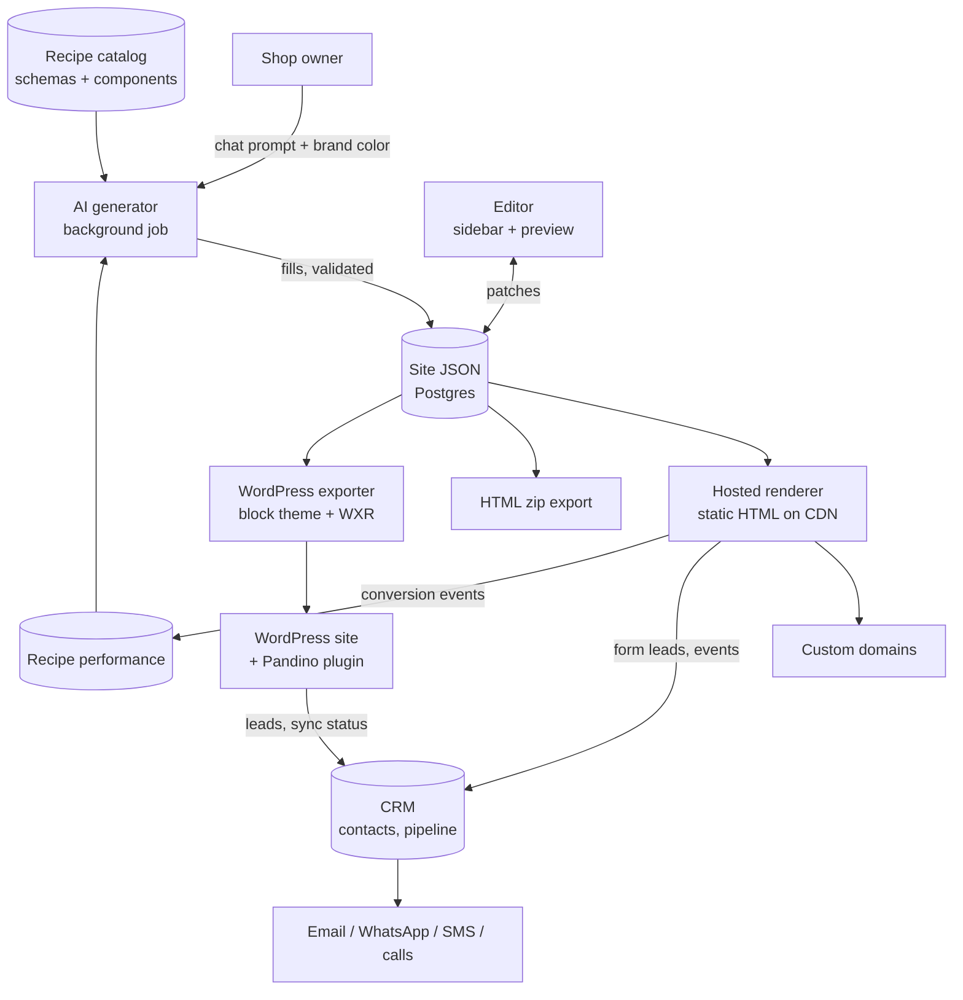
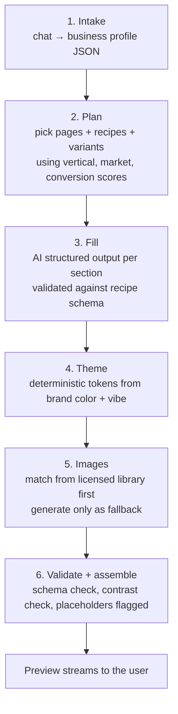
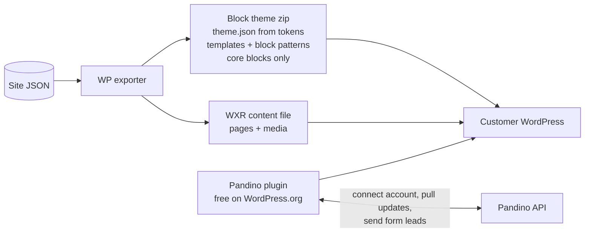
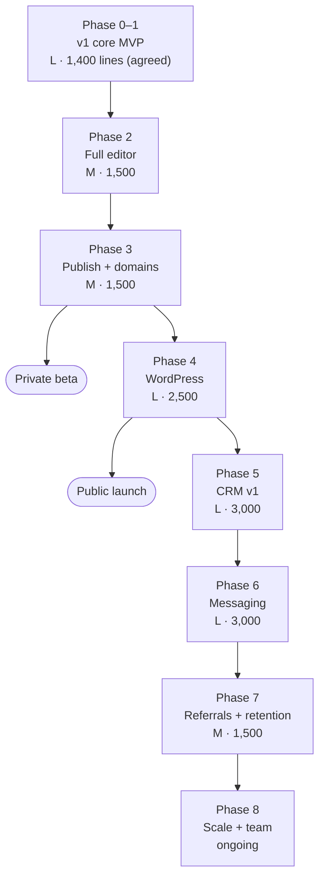

# Pandino — Product & Technical Build Plan

**AI website builder + client CRM for the car aftermarket (Italy and USA)**

Version 1.0 · 19 October 2026 · For: the founder and the first engineers

---

## 1. One-page summary

**What Pandino is.** A shop owner (garage, auto repair, body shop, tyre shop, glass shop) types a short description of their business and picks a brand color. Pandino builds a complete website from pre-designed **recipes** (ready sections that sell services). AI writes the text, picks or generates images, and matches colors and fonts to the brand. The owner then edits in a simple dashboard, publishes on Pandino (with their own domain), or exports to **HTML** or **WordPress**. Every site comes with a built-in **client-first CRM** so the shop can turn visitors into clients and keep them for life.

**The one big technical decision.** Every site is **one structured JSON document** (the *site schema*). AI fills it, the editor changes it, and different *renderers* turn it into a hosted site, an HTML zip, or a WordPress block theme. One source of truth, many outputs.

**Stack (agreed).** TypeScript · Next.js (React) · Postgres on Supabase with row-level security · Vercel for the app, Cloudflare for published sites and custom domains · Trigger.dev for background jobs · Stripe · Resend/Postmark · Twilio + Meta WhatsApp Cloud API. React was chosen partly because the WordPress editor (Gutenberg) is React, so editor parts can be reused in the WordPress plugin.

**Agreed decisions (confirmed by the founder).**

| Decision | Status |
|---|---|
| Site = one canonical JSON document; everything else is a renderer | Agreed |
| Stack as listed above | Agreed |
| **First version (Phase 0–1 core MVP) has a hard budget of 1,400 lines of code** | **Agreed** |
| **Every later phase gets its own explicit line budget before work starts** | **Agreed** (numbers in §5 are *proposed*) |
| English first; data model ready for Italian from day one | Agreed |
| Launch narrow, add messaging channels one at a time | Agreed |

**Roadmap in one line.** v1 core MVP (prompt → site → editor → HTML + basic WordPress export, 1,400 lines) → full editor → publish & domains & lead inbox (private beta) → full WordPress export + plugin (public launch) → CRM → messaging (WhatsApp Italy, SMS USA, calls) → referrals & retention → scale & team.

**This week.** Create the GitHub repo `Tami-vibe/pandino`, write schema v0, port two recipes to React, prove one JSON → static HTML and → WordPress, and prove one AI fill with structured output. Details in §9.

---

## 2. Product vision and who it is for

### 2.1 The customer

| Segment | What they sell | What their website must do |
|---|---|---|
| General garage / auto repair | Servicing, diagnostics, brakes, MOT/inspection-type checks | Show services with "from" prices, take bookings, show reviews and certifications |
| Body shop (carrozzeria) | Collision repair, paint, dents | Quote request with photo upload, before/after gallery, insurance claims help |
| Tyre shop (gommista) | Tyres, seasonal changes, alignment | Tyre size finder, financing, seasonal booking |
| Glass shop | Windscreen repair/replacement, ADAS calibration | Fast quote, insurance help, mobile service area |

Most owners are busy, not technical, and get clients from phone calls, WhatsApp (Italy), SMS (USA), Google reviews and word of mouth. Pandino should feel like "my site and my client list, done for me".

### 2.2 The promise

1. **A good site in minutes**, made from proven sections — not a random AI layout.
2. **Easy to change** — visual controls or "ask AI to change this".
3. **Yours to take anywhere** — host with us, download HTML, or export to WordPress in one click.
4. **More repeat clients** — every lead lands in a simple CRM with reminders, follow-ups and referral rewards.

### 2.3 Product rules baked into every generated site

- Every site ships with a **lead form**, a **booking / quote button**, and a **share-and-reward link**.
- Every section records simple conversion events (view, button click, form sent, call tap, WhatsApp tap). Over time the AI prefers the recipes and variants that convert best for that type of shop and market.
- **No fake proof.** The AI never invents reviews, before/after photos, certifications or prices. These come from the owner (or a connected Google profile). AI may write placeholders that are clearly marked and cannot be published unedited.

### 2.4 About WordPress export (honest view)

Tools that convert HTML or other builders to WordPress already exist. Pandino's edge is narrower and stronger: **any site generated in Pandino exports in one click to a native Gutenberg block theme**, and stays **connected** to Pandino through a free plugin (design/content updates, form leads into the CRM). That connection lets Pandino know how many WordPress users it has (only through connected accounts) and build plugins that help them grow.

---

## 3. Core architecture

### 3.1 Big picture



### 3.2 The parts

| Part | Job | Notes |
|---|---|---|
| **Site schema** | The single source of truth for one site | Zod schema in TypeScript; exported as JSON Schema for AI structured output; has a `schemaVersion` and migrations |
| **Recipe** | One pre-designed section type (e.g. `hero.split-photo`) | Each recipe = field schema + React component + variants + WordPress block template + sample data |
| **Theme engine** | Brand color + vibe → design tokens | Deterministic code, not AI: palette in OKLCH with contrast checks, font pairing from presets (the mockup's 5 pairings: Syne, Manrope, DM Serif Display, Montserrat/Playfair, Poppins), radius, spacing |
| **Generator** | Prompt → site JSON | Steps: intake → plan pages/recipes → fill fields → theme → images → validate |
| **Editor** | Changes the JSON | Every change is a small patch (makes undo/redo, autosave and AI edits simple) |
| **Renderers** | JSON → output | Same React components render hosted pages and HTML export; WordPress exporter maps recipes to block markup |
| **CRM** | Leads and clients | Contacts, vehicles, pipeline, activity, consent records, referrals |
| **Jobs** | Slow work | Generation, image work, publishing, exports, campaigns, sync |

### 3.3 Site JSON example (one hero section)

All text a visitor sees is stored as a **locale map** (`{"en-US": "..."}`) from day one. Adding Italian later means adding `"it-IT"` keys, not changing the model.

```json
{
  "schemaVersion": 1,
  "siteId": "site_01JB7Q4M2X",
  "workspaceId": "ws_01JB7Q3ZK9",
  "locales": { "default": "en-US", "enabled": ["en-US"] },
  "business": {
    "name": "Rossi Auto Body",
    "vertical": "body_shop",
    "market": "US",
    "phone": "+15550100100",
    "address": { "city": "Columbus", "region": "OH", "country": "US" },
    "certifications": ["i-car-gold", "ase"]
  },
  "theme": {
    "brandColor": "#E4572E",
    "vibe": "bold-trustworthy",
    "palette": { "primary": "#E4572E", "onPrimary": "#FFFFFF", "surface": "#FAFAF9", "text": "#1C1917" },
    "fonts": { "heading": "Manrope", "body": "Inter" },
    "radius": "md",
    "spacing": "comfortable"
  },
  "pages": [
    {
      "id": "pg_home",
      "slug": "/",
      "title": { "en-US": "Home" },
      "sections": [
        {
          "id": "sec_hero_1",
          "group": "hero",
          "recipe": "hero.split-photo",
          "recipeVersion": 3,
          "variant": "image-right",
          "fields": {
            "eyebrow": { "en-US": "I-CAR Gold Class certified" },
            "headline": { "en-US": "Collision repair done right, the first time" },
            "subhead": { "en-US": "Free estimates. We work with all insurance companies." },
            "primaryCta": {
              "label": { "en-US": "Get a free quote" },
              "action": { "type": "open_form", "formId": "frm_quote" }
            },
            "secondaryCta": {
              "label": { "en-US": "Call (555) 010-0100" },
              "action": { "type": "tel", "value": "+15550100100" }
            },
            "image": { "assetId": "ast_7f3k" }
          },
          "style": { "background": "surface", "overlay": 0 }
        }
      ]
    }
  ],
  "assets": {
    "ast_7f3k": {
      "type": "image",
      "src": "https://cdn.pandino.example/ws_01JB7Q3ZK9/ast_7f3k.webp",
      "alt": { "en-US": "Technician polishing a repaired red sedan" },
      "source": "library",
      "width": 1600,
      "height": 1067
    }
  },
  "forms": {
    "frm_quote": { "kind": "quote", "photoUpload": true, "consent": ["contact", "marketing_optional"] }
  }
}
```

### 3.4 How generation works



Rules: the AI never writes HTML or CSS, only field values. Invalid output is retried with the validation error. Each generation records model, tokens, cost and duration, so we always know the cost per site.

**AI edits** ("make the hero more premium") send only the selected section plus its schema; the model returns a patch; the editor shows the change and it can be undone.

### 3.5 Publishing and custom domains

Publishing renders the JSON to **static HTML files** (the same output as the HTML export) and uploads them to object storage behind a CDN. A small edge worker picks the site by hostname. Custom domains use Cloudflare for SaaS (custom hostnames with automatic SSL). Static sites are fast, cheap, and keep working even if the app is down. Forms and events post to the Pandino API.

### 3.6 WordPress: export and the plugin bridge



- **Theme** = only presentation: `theme.json` generated from brand tokens, templates, and each recipe as a **block pattern built from core blocks**. WordPress.org theme rules do not allow custom blocks, shortcodes, contact forms, analytics or demo importers inside themes.
- **Plugin** ("Pandino", free) = everything functional: connect to a Pandino account, pull design/content updates (data only, never code), custom blocks for interactive recipes (quote form with photo upload, tyre size finder, reviews), send form leads to the CRM, and the free editor sidebar inside Gutenberg.
- **Sync direction (v1): one-way, Pandino → WordPress.** Pandino is the source of truth. If the owner edits in WordPress, the plugin warns before overwriting and offers "detach". Two-way sync is an open question (§8).
- **Counting WordPress users** = counting connected accounts (the user registers and connects; this counts as consent for a SaaS). No anonymous tracking of installs.

### 3.7 WordPress.org rules we must respect (checked 19 Oct 2026)

| Rule | What it means for Pandino | Source |
|---|---|---|
| Everything in a listed theme/plugin must be GPL-compatible (code, data, images) | Free themes and the plugin are GPLv2-or-later. Generator, CRM and sync service stay proprietary because they run as SaaS on our servers | [Plugin guideline 1](https://developer.wordpress.org/plugins/wordpress-org/detailed-plugin-guidelines/), [Theme requirements §1](https://make.wordpress.org/themes/handbook/review/required/) |
| SaaS plugins are allowed if the service has real substance and is documented in the readme | The plugin is an interface to Pandino; document it with links to Terms and Privacy | Plugin guideline 6 |
| No trialware: no locked features in plugin code | The plugin's free editor must be fully usable; paid value lives in the service (AI, CRM, messaging) | Plugin guideline 5 |
| No tracking or external calls without explicit opt-in | Plugin talks to Pandino only after the user connects an account; theme makes no external calls | Plugin guideline 7, Theme §2 and §9 |
| No executable code from our servers; updates only via WordPress.org | Sync sends JSON/block content/styles, never PHP/JS | Plugin guideline 8 |
| "Powered by" credits must be opt-in | No forced footer credit in exports | Plugin guideline 10; Theme §13 |
| Themes: no custom blocks, post types, shortcodes, forms, analytics, SEO, social buttons ("plugin territory"); no demo imports | Interactive recipes live in the plugin; theme uses core blocks only | [Theme requirements §5, §6, §12](https://make.wordpress.org/themes/handbook/review/required/) |
| Themes: bundle all assets locally (Google Fonts is the only exception); no CDN | Bundle compiled CSS, fonts and Material Symbols subset in the theme zip (no Tailwind CDN) | Theme §9 |
| Block themes need `style.css`, `readme.txt`, `theme.json`, `templates/index.html`; strings translatable; prefix of 4+ letters | Exporter produces these; prefix `pandino_` | Theme §4, §8, §11 |
| Names must not use "WordPress", "Theme", "Twenty"; slug must not start with another brand | Plugin slug `pandino`, themes like `pandino-garage` | Theme §7, Plugin guideline 17 |
| One theme in review at a time | Plan theme submissions one by one | Theme §14 |

Recheck these pages before every submission; the rules change.

### 3.8 Compliance by market

| Topic | Italy / EU | USA | Built where |
|---|---|---|---|
| Role | Shop is data controller for its clients; Pandino is processor → DPA with every customer, public sub-processor list | Same contract model | Phase 3 |
| Consent | Separate, unticked checkboxes for contact vs marketing; store who, when, what text, which form | TCPA: prior express written consent for marketing texts/calls; store proof | Forms in v1, records in Phase 3 |
| Data rights | Export and delete a contact or a whole workspace; retention rules | State privacy laws: same tools cover most needs | Phase 3 + Phase 5 |
| First channel | **WhatsApp**: Business verification, approved templates, 24-hour service window | **SMS**: A2P 10DLC brand + campaign registration per shop, STOP/HELP, quiet hours | Phase 6 |
| Calls | Recording only with notice/consent | Recording consent rules differ by state | Phase 6 |
| Message costs | Meta charges per message/template category | Carrier and Twilio fees per segment and number | Passed into pricing (open question) |

Pandino gives tools for compliance; it must not claim to *guarantee* compliance (also a WordPress.org rule for the plugin, guideline 9).

---

## 4. Tech stack

| Area | Choice | Why | Alternatives |
|---|---|---|---|
| Language | **TypeScript** | One language front to back; types catch schema mistakes; huge hiring pool | JavaScript (fine for the prototype, risky at scale) |
| App, editor, marketing | **Next.js (React)** | Most common React framework; easy to hire for; React matches Gutenberg | Remix, SvelteKit (smaller hiring pool, no Gutenberg reuse) |
| Styling | **Tailwind CSS 4** (built, not CDN) | Prototype already uses it | daisyUI 5 can stay for app UI; published sites use our own tokens |
| Icons | **Material Symbols Rounded** (self-hosted subset) | Already in the design; Apache 2.0 | Lucide |
| Schema & validation | **Zod** → JSON Schema | One definition for types, validation and AI structured output | Valibot, TypeBox |
| Editor state | **Zustand** + patch commands | Small, easy to learn; patches give undo/redo | Redux Toolkit, Immer only |
| Database | **Postgres on Supabase** with row-level security per workspace | Postgres + Auth + Storage in one place; EU and US regions | Neon + Clerk + S3 (more vendors, more flexibility) |
| Auth | **Supabase Auth** | Same vendor as data; works with RLS | Clerk (nicer UI, extra vendor) |
| Object storage | **Supabase Storage** for uploads, **Cloudflare R2** for published sites | Simple uploads; cheap egress for public files | S3 |
| App hosting | **Vercel** | Best fit for Next.js, preview deploys per PR | Cloudflare Pages, Fly.io |
| Published sites + custom domains | **Cloudflare** (R2 + Worker + Cloudflare for SaaS custom hostnames) | Built for many customer domains with automatic SSL | Vercel Domains API (simpler, check domain limits per plan) |
| Background jobs | **Trigger.dev** | Long AI tasks, retries, TypeScript-native | Inngest |
| AI | Provider-agnostic wrapper (e.g. Vercel AI SDK) | Swap models per step; structured output support | Direct vendor SDK |
| Billing | **Stripe** (subscriptions + usage metering) | Standard; supports EU VAT and US tax tools | Paddle (merchant of record) |
| Email | **Postmark** or **Resend**; separate streams for transactional and marketing; per-customer sending domains | Deliverability; required one-click unsubscribe for bulk mail | SES (cheaper, more work) |
| SMS / voice | **Twilio** | 10DLC registration tools for platforms (ISV), voice, numbers | Telnyx, Vonage |
| WhatsApp | **Meta WhatsApp Cloud API** with Embedded Signup (or via Twilio) | Each shop connects its own number | Twilio WhatsApp (one vendor, extra fee) |
| Monitoring | Sentry, PostHog (EU cloud) | Errors, product analytics, feature flags | Datadog |
| Tests | Vitest, Playwright with screenshot tests per recipe | Recipes are the product: catch visual breaks | Cypress |
| Monorepo | pnpm + Turborepo | Simple, common | Nx |
| WordPress | PHP + `@wordpress/scripts`, `wp-env` / WordPress Playground for tests | Official tooling | — |

### 4.1 Repository layout

```
pandino/
  apps/
    web/            Next.js: marketing, dashboard, generator chat, editor
    sites/          Edge worker that serves published static sites by hostname
  packages/
    schema/         Zod site schema, types, migrations, JSON Schema export
    recipes/        One folder per recipe: schema.ts, Component.tsx, wp.ts, sample.json
    theme/          Brand color → tokens, font presets, contrast checks
    renderer/       JSON → React → static HTML (+ compiled CSS)
    export-wp/      theme.json, templates, patterns, WXR
    ai/             Prompts, generation steps, eval set
    ui/             Shared editor controls (also used by the WP plugin)
  jobs/             Trigger.dev tasks
  wordpress/
    plugin/         "Pandino" plugin (PHP + React via wp.element)
    themes/         Free recipe-based themes for WordPress.org
  prototype/        Frozen copy of the vanilla JS prototype (reference only)
  docs/             This plan, decisions (ADRs), recipe guide
```

**Note on sharing React with WordPress.** WordPress ships its own React (`wp.element`). Shared components in `packages/ui` must treat React as a peer dependency and avoid features newer than the React version bundled with current WordPress.

### 4.2 Migrating the prototype

The prototype (vanilla HTML/CSS/JS, Tailwind 4 + daisyUI 5 via CDN, Material Symbols, state in `js/app.js`, `runtime.js`, `storage.js`) and the sidebar mockup (`pandino-sidebar/`) are the design reference.

| Prototype piece | Becomes | How |
|---|---|---|
| Recipe HTML + CSS | `packages/recipes/*/Component.tsx` | Copy markup to JSX, keep Tailwind classes, replace hard-coded text/images with `fields`, colors with token CSS variables |
| Sidebar mockup (icon rail + flyout, light/dark) | `apps/web` editor shell | Port `sidebar.css` variables to Tailwind theme; groups stay the same: Pages, Style, Hero, Pains, Services, Trust, Convert, Footer |
| Font pairings in mockup | `packages/theme` presets | Same five pairings, self-hosted |
| `app.js` state | Site JSON + Zustand store | Every UI action becomes a patch on the JSON |
| `runtime.js` behaviors | React hooks / small client "islands" | Only interactive parts ship JavaScript on published sites |
| `storage.js` (local) | API + Postgres | Keep localStorage only as an offline draft cache |
| Tailwind / daisyUI via CDN | Built Tailwind 4 (`@tailwindcss/postcss`) | Needed for speed, and WordPress.org forbids CDN assets |
| Material Symbols via Google Fonts | Self-hosted subset | Faster, and avoids sending visitor IPs to a third party |

**For the founder (vanilla JS → TypeScript):** TypeScript is JavaScript with labels on data. Start by writing recipes: a recipe is one component plus one Zod schema, which is the easiest place to learn. Engineers own the plumbing.

---

## 5. Phased roadmap

### 5.1 How we size and budget work

- **Size:** S (small), M (medium), L (large) — relative effort, not dates. Recalibrate after v1 is done.
- **Line budget (agreed rule):** each phase has a maximum number of lines of code. If a phase needs more, we cut scope or the founder approves a new number *before* writing more code. A small budget forces reuse and keeps the product narrow.
- **What counts:** non-blank, non-comment lines of TypeScript/TSX/JS/PHP that we write in `apps/`, `packages/`, `jobs/`, `wordpress/`. **Not counted:** tests, config, generated files, lockfiles, CSS, JSON fixtures/sample data, prompts stored as text, and the frozen prototype. CI runs `cloc` on every pull request and fails if a phase goes over budget.

| Phase | Name | Size | Line budget | Status of budget |
|---|---|---|---|---|
| 0–1 | **v1 core MVP**: prompt → site → editor → HTML + basic WP export | L | **1,400** | **Agreed** |
| 2 | Full editor (sidebar port, AI edit, versions) | M | 1,500 | Proposed |
| 3 | Publish, custom domains, lead inbox, billing → **private beta** | M | 1,500 | Proposed |
| 4 | Full WordPress export + plugin bridge + WP.org theme → **public launch** | L | 2,500 (incl. PHP) | Proposed |
| 5 | CRM v1 (contacts, vehicles, pipeline, email) | L | 3,000 | Proposed |
| 6 | Messaging: WhatsApp (IT), SMS (US), calls | L | 3,000 | Proposed |
| 7 | Referrals, retention, upsell automation, recipe learning loop | M | 1,500 | Proposed |
| 8 | Scale & team (Italian, agencies, reliability) | L, ongoing | Set per initiative (e.g. Italian localization 800) | Proposed |



### 5.2 Phase 0–1 — v1 core MVP (agreed budget: 1,400 lines)

**Goal:** prove the core loop end to end: a shop owner writes a prompt, gets a real site made of recipes, changes it in the sidebar editor, and downloads it as HTML or as a basic WordPress block theme.

**In scope:** repo + CI, schema v0, theme engine, 8 core recipes, AI generation, minimal editor, save/load, HTML export, basic WP theme export.
**Out of scope (later phases):** hosting and domains, billing, CRM, messaging, WP plugin, image generation (library images only), Italian.

**Line budget split (1,400 total):**

| Module | Lines | What it contains |
|---|---|---|
| `schema` | 120 | Site, page, section, theme, asset, form types; locale maps; version field |
| `theme` | 85 | Brand color → palette (OKLCH, contrast check), 5 font presets, radius/spacing |
| `recipes` | 360 | 8 recipes × ~30 lines (Zod fields + JSX; Tailwind classes count as markup) |
| `renderer` | 65 | Page assembly, static HTML render, CSS inlining |
| `ai` | 290 | Intake → plan → fill, schema validation, one retry, cost logging |
| Prompt UI | 155 | Chat box, brand color picker, generation progress |
| Editor | 200 | Icon rail + flyout, controls generated from recipe schemas, inline text edit, reorder/add/remove section, undo/redo, light/dark |
| Persistence + auth | 55 | Supabase auth, save/load site JSON with RLS |
| Exports | 70 | HTML zip (~30); WP block theme with `theme.json` + patterns from core blocks for the 8 recipes (~40) |
| **Total** | **1,400** | |

**The 8 core recipes for v1:**

| Sidebar group | Recipe | Automotive detail |
|---|---|---|
| Hero | `hero.split-photo` | Headline, quote CTA + call CTA, certification eyebrow |
| Pains | `pains.cards` | "Strange noise? Warning light? Insurance stress?" |
| Services | `services.menu-from-prices` | Service list with "from" prices, duration, icon |
| Services | `services.process-insurance` | Repair process steps + "we handle your insurance claim" |
| Trust | `trust.reviews-certs` | Review cards (owner-entered in v1) + ASE / I-CAR / OEM badges (only if confirmed) |
| Trust | `trust.before-after` | Before/after gallery from owner's real photos |
| Convert | `convert.quote-booking` | Quote/booking form with photo upload field, booking button |
| Footer | `footer.contact-map` | Hours, address, map link, share-and-reward link |

**Done when:**
- [ ] Repo `Tami-vibe/pandino` exists with CI (lint, typecheck, tests, line-budget check).
- [ ] A prompt like "Body shop in Columbus, Ohio, insurance work, brand color #E4572E" produces a valid site JSON with 6–8 sections, every time, in the eval set.
- [ ] No generated site has invented reviews, certifications or prices; placeholders are flagged.
- [ ] Brand color always yields text with readable contrast (automated check).
- [ ] The owner can edit any field, reorder sections, undo, switch light/dark in the editor; changes persist after reload.
- [ ] HTML zip opens offline and looks like the preview (screenshot test).
- [ ] WP theme zip installs on a clean WordPress (wp-env/Playground) and shows all 8 recipes with brand colors.
- [ ] `cloc` shows ≤ 1,400 counted lines.
- [ ] Cost and time per generation are logged and visible in an internal page.

### 5.3 Phase 2 — Full editor (proposed: 1,500 lines, M)

**Goal:** the editor from the mockup, complete and pleasant.
**Deliverables:** full Pages & Layers panel (multi-page, page settings, SEO title/description); Style panel (palette, fonts, radius, spacing, effects as in mockup); every group's flyout with custom controls where auto-generated ones are not enough; tooltips and keyboard shortcuts (1–8 to jump groups, as in mockup); **AI edit** per section and per page with visible diff and undo; version history (restore any save); image replace/upload/crop; mobile preview; variant switcher per section; next automotive recipes: **tyre size finder + financing** (`services.tyre-finder`), **Google reviews** connected to the shop's Google profile (check Google's display terms), glass/ADAS calibration service block.
**Done when:**
- [ ] All controls in the mockup screenshots exist and work in light and dark mode.
- [ ] AI edit only touches the selected section and can always be undone.
- [ ] Ten non-technical test users can change headline, color and a service price without help.
- [ ] Budget respected.

### 5.4 Phase 3 — Publish, domains, lead inbox, billing (proposed: 1,500 lines, M) → private beta

**Goal:** a shop can go live and receive leads.
**Deliverables:** publish to `*.pandino` subdomain (static files on R2 + edge worker); custom domains with automatic SSL and clear DNS instructions; forms post to a **simple lead inbox** with email notification to the owner; consent checkbox on forms and a stored consent record; SEO basics (sitemap, meta, `AutoRepair`/`LocalBusiness` structured data); cookie-less aggregate analytics for section events (confirm consent needs in Italy with counsel); share-and-reward link (tracks who shared, reward handled manually for now); Stripe subscription with trial; GDPR basics: privacy policy, DPA template, sub-processor list, delete account/data.
**Done when:**
- [ ] A site goes live on a custom domain with HTTPS without support help.
- [ ] A test form submission arrives in the inbox and by email in under a minute.
- [ ] Published pages are static and still load when the app is down.
- [ ] Billing works end to end (subscribe, upgrade, cancel, failed card).
- [ ] Data export and deletion work for a workspace.

### 5.5 Phase 4 — WordPress export + plugin bridge (proposed: 2,500 lines incl. PHP, L) → public launch

**Goal:** the key differentiator: one-click export of any Pandino site to a native block theme, connected back to Pandino.
**Deliverables:** full exporter (templates, template parts, all recipes as patterns, style variations, WXR with pages and media); **Pandino plugin**: account connect (opt-in), one-way sync of content/styles (data only), custom blocks for interactive recipes (quote form with photo upload, tyre size finder, reviews), leads to CRM, free editor sidebar in Gutenberg reusing `packages/ui`; admin notices dismissible; readme with service and privacy docs. Submit plugin, then **one** free recipe-based theme to WordPress.org (core blocks only). Internal dashboard: connected WP sites count.
**Done when:**
- [ ] Every recipe exports to WordPress and passes a visual check against the hosted version ("close, not pixel-identical" unless the founder decides otherwise).
- [ ] Theme passes the Theme Check plugin; plugin passes the Plugin Check tool.
- [ ] A change in Pandino reaches a connected WP site after "Sync", with a warning if the WP content was edited locally.
- [ ] A form on a WP site creates a lead in Pandino.
- [ ] Plugin is approved on WordPress.org; theme submitted.

### 5.6 Phase 5 — CRM v1 (proposed: 3,000 lines, L)

**Goal:** a client-first CRM a garage actually uses.
**Deliverables:** contacts with **vehicles** (make, model, year, plate, tyre size); pipeline with default stages (New → Contacted → Quote sent → Booked → In service → Completed → Review requested → Repeat client); activity timeline; email 1:1 and simple broadcasts with per-customer sending domain; automations: instant auto-reply to new lead, review request after "Completed"; lead magnets as recipes (e.g. "free tyre check", seasonal checklist); consent records per channel and purpose; GDPR tools (export, delete, retention).
**Done when:**
- [ ] Every lead from hosted and WP sites lands in one inbox and pipeline.
- [ ] Marketing email cannot be sent to a contact without marketing consent; unsubscribe is one click.
- [ ] A shop can move a client through the pipeline and send a review request in two clicks.

### 5.7 Phase 6 — Messaging (proposed: 3,000 lines, L)

**Goal:** talk to clients where they are. **One channel at a time:** WhatsApp for Italy first, then SMS for the USA, then calls.
**Deliverables:**
1. **WhatsApp (Italy):** Meta Embedded Signup so each shop connects its own verified WhatsApp Business number; template management and approval status; shared inbox; 24-hour service window handled correctly. Requires Italian site generation (see Phase 8) to be ready.
2. **SMS (USA):** Twilio as ISV; guided **A2P 10DLC** brand + campaign registration per shop (this takes time, so start it at onboarding); consent capture on forms; STOP/HELP handling; quiet hours.
3. **Calls:** tracking number forwarding to the shop, call log in the timeline, **missed-call text-back**; recording only with consent rules per state/country.
4. Usage metering: message and call costs passed into pricing (bundle + overage or pass-through — open question).
**Done when:**
- [ ] An Italian shop can receive and answer WhatsApp messages from the Pandino inbox and send an approved template.
- [ ] A US shop completes 10DLC registration through Pandino and sends compliant SMS.
- [ ] Every outbound marketing message has a stored consent record.
- [ ] Usage appears on the customer's bill.

### 5.8 Phase 7 — Referrals, retention, upsell (proposed: 1,500 lines, M)

**Goal:** keep clients for life.
**Deliverables:** referral program (unique links/codes per client, reward rules, reward status); share tracking from the share-and-reward link; service reminders from vehicle data (next service, seasonal tyre change); upsell and win-back sequences; review generation flow; **recipe learning loop**: conversion scores by recipe × variant × vertical × market feed the generator's planner (only after a minimum number of visits; show "why this recipe" internally).
**Done when:**
- [ ] A client who shares a link and brings a booking is credited automatically.
- [ ] Reminders go out on the right channel with consent.
- [ ] The planner's recipe choice changes based on real data, and this is visible in internal reports.

### 5.9 Phase 8 — Scale and team (budget set per initiative)

**Goal:** handle growth and make the team faster.
**Initiatives (each gets its own proposed budget before start):** Italian localization of UI and generation (proposed 800); agency / multi-site workspaces; more recipes and verticals; two-way WP sync if needed; performance and cost work on AI (cheaper models for simple steps, caching); security review, backups, on-call; public docs and recipe authoring guide.

**About 5k+ subscribers in month one:** 5,000 sites is small for Postgres and static hosting. The real limits are **AI cost per generation**, **image cost**, **support load**, and **messaging onboarding time** (10DLC, WhatsApp verification). Prepare: per-account generation limits, queueing, cost alerts, onboarding guides, and bilingual support before launch marketing.

---

## 6. Team and hiring plan

The stack is mainstream on purpose: TypeScript, React, Next.js, Postgres. That makes hiring easier in Italy and the USA.

| Order | Role | Owns | When |
|---|---|---|---|
| 1 | **Founding full-stack engineer** (TypeScript, Next.js, Postgres) | Schema, renderer, jobs, data, CI, code reviews | Now (v1) |
| 2 | **Design engineer** (React + Tailwind, strong eye) | Recipes, editor UI, screenshot tests | v1–Phase 2 |
| 3 | **WordPress engineer** (PHP, Gutenberg/React, block themes, has passed WP.org review) | Exporter, plugin, theme submissions | Contract from Phase 4 |
| 4 | **Applied AI engineer** (can be #1 early) | Prompts, evals, cost, recipe learning loop | Phase 1 onward, full role by Phase 7 |
| 5 | **Customer success, bilingual IT/EN** | Onboarding, domains, 10DLC/WhatsApp setup help, feedback | Before private beta |
| 6 | **Integrations engineer** | Twilio, WhatsApp, email deliverability | Phase 6 |
| Advisor | Privacy/telecom counsel (EU GDPR + US TCPA) | DPA, consent texts, policies | Phase 3 and Phase 6 |

**Make it easy to join:** README that runs in one command, short architecture decision records (ADRs) in `docs/`, a recipe authoring guide, labelled "good first issue" tasks (new recipe variants are perfect), preview deploys for every PR.

---

## 7. Risks and mitigations

| Risk | Impact | Mitigation |
|---|---|---|
| AI output is inconsistent or generic | Bad first impression | AI fills fields only; recipes control design; eval set per vertical run in CI; deterministic theme |
| AI and image costs grow faster than revenue | Margin | Cost logged per generation; generation limits per plan; cheaper models for simple steps; library images first |
| Fake or misleading content (reviews, before/after, certifications) | Legal and trust | Never generated; owner-entered or connected sources only; placeholders block publish |
| Trademark misuse (ASE, I-CAR, OEM logos, car brands in images) | Legal | Show badges only when owner confirms; follow each program's logo rules; avoid brand logos in generated images |
| WordPress export does not match the hosted site | Breaks the differentiator | Recipes built from simple layout primitives that map to core blocks; visual diff tests; agree on "close" standard |
| WordPress.org review rejects or delays theme/plugin | Delays growth channel | Follow rules in §3.7, run Theme Check / Plugin Check, submit simple versions early |
| Two-way sync complexity | Bugs, lost edits | One-way first, warn before overwrite, "detach" option |
| 10DLC / WhatsApp onboarding takes time or fails | Messaging launch slips | Start registration at signup; guided forms; WhatsApp first in Italy, SMS first in US |
| TCPA / GDPR violations by customers using our tools | Fines, lawsuits | Consent records required to send; quiet hours; STOP handling; DPA; data deletion; counsel review |
| Email deliverability for many small senders | Messages in spam | Per-customer domains with DKIM/SPF/DMARC; separate streams; one-click unsubscribe |
| Scope creep (CRM is huge) | Nothing ships | Line budgets per phase; launch narrow; one channel at a time |
| Line budget too tight for v1 | Pressure to cut quality | Budget excludes tests/CSS/config; reuse libraries; founder decides scope cuts vs new budget explicitly |
| Vendor lock-in | Cost, flexibility | Site JSON is portable; thin wrappers around AI, email, messaging |
| Support load from 5k users | Churn | Self-serve domain wizard, in-app guides, bilingual support hire before launch |

---

## 8. Open questions for the founder

1. **Pricing tiers:** what is free, what is paid; is the CRM in every plan; how are messages and AI generations charged (bundle + overage or pass-through)?
2. **Brand name and domain:** is "Pandino" final; which domain for the app and for published subdomains; trademark check in Italy/EU and USA?
3. **AI model vendor:** one vendor or a mix per step; any data-residency needs for EU customers?
4. **Image strategy:** licensed stock library, AI generation, or both; who curates the automotive image library?
5. **Two-way WordPress sync:** is it needed, or is one-way + "detach" enough?
6. **WordPress fidelity:** must exports be pixel-identical, or "close and native" (recommended)?
7. **Free editor in WordPress:** exactly which features are free in the plugin (must be fully working, no trialware)?
8. **Italy timing:** when do Italian sites and Italian UI launch, given WhatsApp-first in Italy?
9. **Data region:** one EU region for everyone, or EU + US?
10. **Customers:** only single shops, or also agencies managing many shops?
11. **Bookings:** Pandino's own simple booking, or integrations with shop management software used by garages?
12. **Domains:** do we sell/register domains for customers, or only connect existing ones?
13. **Legal entity:** Italy or USA first (affects Stripe, taxes, GDPR role, contracts)?
14. **Line budgets:** are the proposed numbers for Phases 2–8 acceptable, and who can approve an increase?

---

## 9. Next 5 steps (this week)

1. **Create the GitHub repo `Tami-vibe/pandino`** (private). Set up pnpm + Turborepo, `apps/web`, `packages/schema`, `packages/recipes`, CI with lint, typecheck, tests and the `cloc` line-budget check (limit 1,400). Copy the prototype into `prototype/` and this plan into `docs/plan.md`.
2. **Write site schema v0** in Zod with locale maps, plus one full example site JSON (a body shop) and the JSON Schema export.
3. **Port two recipes** (`hero.split-photo`, `services.menu-from-prices`) from the prototype to React + Tailwind and render the example JSON to a static HTML page.
4. **WordPress spike:** turn the same JSON into a block theme (`theme.json` + 2 patterns, core blocks only) and install it in WordPress Playground or `wp-env`. This tests the key differentiator early.
5. **AI spike + decisions:** one prompt → business profile → hero fields with structured output, validated by Zod, cost logged. In parallel, answer open questions 1–4 and 14, and post the founding engineer job description.

---

*Sources for WordPress.org rules: [Detailed Plugin Guidelines](https://developer.wordpress.org/plugins/wordpress-org/detailed-plugin-guidelines/) · [Theme Review: Required](https://make.wordpress.org/themes/handbook/review/required/). Messaging and privacy references to read before Phases 3 and 6: [Twilio A2P 10DLC](https://www.twilio.com/docs/messaging/compliance/a2p-10dlc) · [WhatsApp message templates](https://developers.facebook.com/docs/whatsapp/business-management-api/message-templates) · [WhatsApp pricing](https://developers.facebook.com/docs/whatsapp/pricing) · [GDPR text (EUR-Lex)](https://eur-lex.europa.eu/eli/reg/2016/679/oj) · [FCC on TCPA / robocalls and texts](https://www.fcc.gov/general/telemarketing-and-robocalls). No prices or statistics are stated in this plan on purpose; check vendor pages for current rates.*
